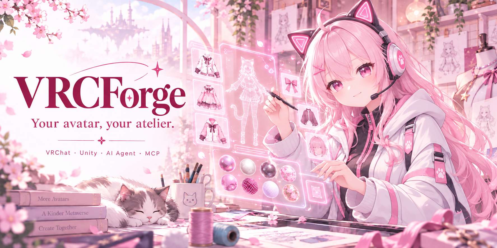

<div align="center">



[](https://github.com/ayyitong888/VRCForge/releases/latest)

[](LICENSE)

[](https://github.com/ayyitong888/VRCForge/stargazers)

[简体中文](README.md) · **English** · [日本語](README.ja.md)


**[Website](https://ayyitong888.github.io/VRCForge/en/)**

</div>

# VRCForge: AI-assisted VRChat avatar editor and Unity MCP tools

VRCForge is an open-source tool for VRChat avatar creators. Describe the face,
clothing, material, or animation change you want in natural language, and the
assistant can inspect your project, suggest a change, and apply it.

> Back up your Unity / VRChat Avatar project before using any asset-writing feature.

Current release: [1.10.7](https://github.com/ayyitong888/VRCForge/releases/tag/v1.10.7) · [Release notes](docs/RELEASE_NOTES_1.10.7.md)

## Download: install both the App and the Unity plugin

**Download both items below from the same Release.**

| Required download | Where to install |
| --- | --- |
| **[App offline installer (.exe)](https://github.com/ayyitong888/VRCForge/releases/download/v1.10.7/VRCForge_Offline_Installer_x64.exe)** | Run on Windows. You may use the [web installer](https://github.com/ayyitong888/VRCForge/releases/download/v1.10.7/VRCForge_Web_Installer_x64.exe) instead; choose one installer. |
| **[Unity Core plugin (VRCForge.unitypackage)](https://github.com/ayyitong888/VRCForge/releases/download/v1.10.7/VRCForge.unitypackage)** | **Import All** into each Unity project you want to connect. Installing the App alone does not connect Unity. |

Update both the App and the Unity plugin when upgrading.

## First run

1. **Back up your project and run the App installer.** Follow the installation prompts.
2. **Open your Unity project and import the plugin.** In Unity, choose `Assets > Import Package > Custom Package…`, open the downloaded `VRCForge.unitypackage`, and click **Import All**. If prompted to install the VRChat Avatar SDK, follow the instructions. Wait for Unity to finish compiling.
3. **Open VRCForge and select that project and Avatar.** Keep Unity open and check that the App shows it as connected. If the project is missing, use **New Project** to add its folder—the one containing `Assets` and `ProjectSettings`.
4. **Set up one AI option below.** Start with: “Inspect this avatar without changing anything.”

Need an Avatar project? Create one with [Creator Companion (VCC)](https://vcc.docs.vrchat.com/guides/getting-started/) or ALCOM. If the connection fails, check that Unity is open, the plugin is imported, and the Console has no red compilation errors.

## Choose your AI

**The built-in agent is still in testing.** External MCP connections and common project operations are generally stable. For day-to-day avatar editing, use an external MCP client.

- **Chat in VRCForge:** Open **Settings → Models**, choose your model service, enter your API key and save. Select a model and test the connection.
- **Use an existing MCP agent:** Open **Settings → Connectors**, turn on **Connect external Agents**, select your client and click **Install MCP config**. You can also copy the general connection instructions to your agent. Keep VRCForge and Unity open, restart or reconnect the client, then ask the agent to inspect the avatar. Turn on **Allow project changes** when you want it to edit. [Detailed connection steps](USER_MANUAL.md#external-agent-connectors)

## Edit, restore and reuse

Review the target and plan before editing, then inspect the appearance and result. Choose per-action confirmation, automatic or full permissions. Automatic mode retains confirmation for high-risk operations; **restoring a checkpoint always requires separate confirmation**. Checkpoints do not replace project backups.

Save common workflows as **Skills**, or import and export **.vsk Skill packs**. [Skill guide](USER_MANUAL.md#skill-packages-and-path-to-skill)

The supported environment is Windows x64, Unity 2022.3 LTS and a VRChat SDK3 Avatar project. Available edits depend on your avatar's controls and installed plugins. Head swaps and part transplants may still need manual mesh, weight or UV work. See the [User Manual](USER_MANUAL.md) and [compatibility matrix](docs/COMPATIBILITY_MATRIX.md) for support and limitations.

## Documentation

- [User Manual / 使用手册](USER_MANUAL.md)
- [1.10.7 release notes](docs/RELEASE_NOTES_1.10.7.md)
- [Compatibility matrix](docs/COMPATIBILITY_MATRIX.md)
- [Product regression contract](docs/PRODUCT_REGRESSION_CONTRACT.md)
- [Optimization strategy](docs/OPTIMIZATION_STRATEGY.md)
- [Unity Package guide](packaging/README.md)
- [Dependencies and licenses](DEPENDENCIES.md) · [NOTICE](NOTICE) · [SECURITY](SECURITY.md)

## Develop from source

Normal users should prefer the Release installer. For source development, run
these commands from the repository root:

```powershell
python -m pip install -r requirements.txt
start_dashboard.cmd
```

Read [CONTRIBUTING.md](CONTRIBUTING.md) and [CODE_OF_CONDUCT.md](CODE_OF_CONDUCT.md)
before contributing.

## Privacy and license

Project indexes, chats, memory and checkpoints are stored locally by default. Content sent to external model services depends on your model and operation. Keep keys, paid assets and private files out of public material, and review diagnostic bundles before sharing. [Privacy details](USER_MANUAL.md#privacy-boundary)

VRCForge is licensed under [GPL-3.0-only](LICENSE). Its Unity MCP Core and tool contracts are project-owned implementations; the public package does not bundle third-party Unity MCP runtime code. See [DEPENDENCIES](DEPENDENCIES.md) and [NOTICE](NOTICE) for third-party dependencies and notices.
