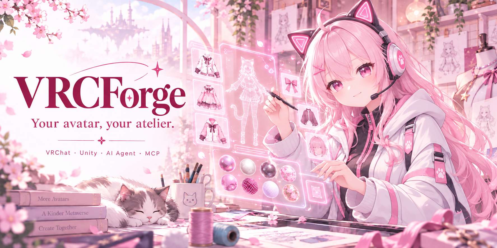

<div align="center">



[](https://github.com/ayyitong888/VRCForge/releases/latest)

[](LICENSE)


[简体中文](README.md) · [English](README.en.md) · **日本語**


**[公式サイト](https://ayyitong888.github.io/VRCForge/ja/)**

</div>

# VRCForge：VRChat アバター改変を支援する AI 工房

VRCForge は、Booth などでアバターや衣装を選ぶクリエイター向けの、Windows 用
オープンソースのアバター編集ツール です。変更したい顔立ち、衣装、マテリアル、
アニメーションを自然な言葉で伝えると、アバターを確認し、変更を提案して適用できます。

> Unity / VRChat Avatar プロジェクトを書き換える機能を使う前に、必ずバックアップしてください。

現在の正式版：[1.10.2](https://github.com/ayyitong888/VRCForge/releases/tag/v1.10.2) · [更新内容](docs/RELEASE_NOTES_1.10.2.md)

## ダウンロード：App と Unity プラグインの両方が必要

**同じ Release から、以下の両方をダウンロードしてください。**

| 必須ダウンロード | インストール先 |
| --- | --- |
| **[App オフラインインストーラー（.exe）](https://github.com/ayyitong888/VRCForge/releases/download/v1.10.2/VRCForge_Offline_Installer_x64.exe)** | Windows で実行。[Web インストーラー](https://github.com/ayyitong888/VRCForge/releases/download/v1.10.2/VRCForge_Web_Installer_x64.exe) でも可。どちらか一つを選びます。 |
| **[Unity Core プラグイン（VRCForge.unitypackage）](https://github.com/ayyitong888/VRCForge/releases/download/v1.10.2/VRCForge.unitypackage)** | 接続する各 Unity プロジェクトに **Import All**。App のインストールだけでは Unity に接続できません。 |

アップグレード時も App と Unity プラグインの両方を更新してください。

## 3 ステップで開始

1. **プロジェクトをバックアップし、App をインストールします。** App はまだ起動しないでください。
2. **Unity プラグインを導入します。** Unity 2022.3 LTS の対象プロジェクトで Import All を選び、設定画面の案内に従って VRChat Avatar SDK などの不足する依存関係を追加します。コンパイル後に `[VRCForge MCP] Core Ready` が出るまで待ちます。
3. **App を起動し、プロジェクトと Avatar を選びます。** 以下のいずれかの AI を設定します。最初は読み取りだけの確認を依頼し、その後に小さな変更を試して結果を確認してください。

新しい Avatar プロジェクトには [Creator Companion（VCC）](https://vcc.docs.vrchat.com/guides/getting-started/) や ALCOM を利用できます。既存の管理ツールを変更する必要はありません。旧版からの更新前に [リリースノート](https://github.com/ayyitong888/VRCForge/releases) を確認してください。`1.4.0` は `1.3.6` に直接上書きできません。

## AI を選ぶ

- **内蔵 AI：** AI 設定でモデルサービスの API キーを入力し、モデルを選んで接続をテストします。その後、チャットで作業を依頼できます。
- **外部 MCP エージェント：** 設定のコネクターページでクライアントを選び、接続設定をインストールするか、表示された設定をエージェントに渡します。VRCForge を起動したままクライアントを再起動・再接続し、エージェントに接続テストを依頼してください。設定済みでも、接続済みとは限りません。[接続の詳細](USER_MANUAL.md#external-agent-connectors)

## 編集・復元・手順の再利用

編集前に対象と計画を確認し、編集後に見た目と結果を確認してください。操作ごとの確認、自動、完全権限のモードを選べます。自動モードでも高リスク操作は確認し、**チェックポイントの復元には常に別途確認が必要です**。チェックポイントはプロジェクトのバックアップの代わりにはなりません。

よく使う手順は **Skills** として保存でき、**.vsk スキルパッケージ** の読み込み・書き出しもできます。[スキルの使い方](USER_MANUAL.md#skill-packages-and-path-to-skill)

動作環境は Windows x64、Unity 2022.3 LTS、VRChat SDK3 Avatar プロジェクトです。編集できる範囲はアバターの調整項目と導入済みプラグインによって異なります。頭部交換やパーツ移植には、メッシュ・ウェイト・UV の手作業が必要な場合があります。対応範囲と制限は [ユーザーマニュアル](USER_MANUAL.md) と [互換性一覧](docs/COMPATIBILITY_MATRIX.md) を参照してください。

## ドキュメントと開発

- [ユーザーマニュアル](USER_MANUAL.md)：操作手順、診断、コマンドライン、トラブルシューティング
- [最適化](docs/OPTIMIZATION_STRATEGY.md) · [Unity パッケージ作成](packaging/README.md) · [回帰検証の要件](docs/PRODUCT_REGRESSION_CONTRACT.md)
- [貢献ガイド](CONTRIBUTING.md) · [行動規範](CODE_OF_CONDUCT.md) · [セキュリティ報告](SECURITY.md)

通常は上記のインストーラーをご利用ください。ソースから開発する場合は、リポジトリのルートで実行します。

```powershell
python -m pip install -r requirements.txt
start_dashboard.cmd
```

## プライバシーとライセンス

プロジェクト索引、チャット、メモリ、チェックポイントは既定でローカルに保存されます。外部モデルサービスに送る内容はモデルと操作によって異なります。キー、有料アセット、非公開ファイルは公開せず、診断データを共有する前に内容を確認してください。[プライバシーの詳細](USER_MANUAL.md#privacy-boundary)

VRCForge は [GPL-3.0-only](LICENSE) で公開されています。Unity MCP Core とツール契約はプロジェクト独自の実装で、公開パッケージに第三者の Unity MCP ランタイムコードは含めていません。第三者の依存関係と表記は [DEPENDENCIES](DEPENDENCIES.md) と [NOTICE](NOTICE) を参照してください。
