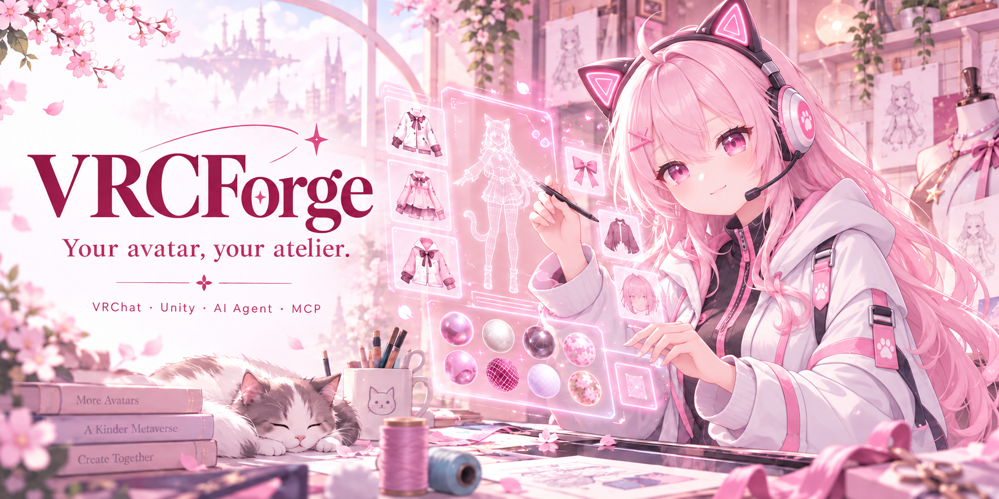

<div align="center">



[](https://github.com/ayyitong888/VRCForge/releases/latest)

[](LICENSE)

[](https://github.com/ayyitong888/VRCForge/stargazers)

**简体中文** · [English](README.en.md) · [日本語](README.ja.md)

**[官网](https://ayyitong888.github.io/VRCForge/)**

</div>

# 用 AI 辅助 VRChat Avatar 改模

VRCForge 是给 VRChat Avatar 创作者使用的开源改模工具。你可以用自然语言说出想改的
脸型、衣服、材质或动画，让助手查看工程、提出修改并实际应用。

> 使用任何会写入 Unity 资产的功能前，请先备份 Unity / VRChat Avatar 工程。

当前正式版：[1.10.2](https://github.com/ayyitong888/VRCForge/releases/tag/v1.10.2) · [更新说明](docs/RELEASE_NOTES_1.10.2.md)

## 下载：App 和 Unity 插件都要装

**下面两项都要下载，使用同一 Release 的配套版本。**

| 必需下载 | 安装到哪里 |
| --- | --- |
| **[App 离线安装包（.exe）](https://github.com/ayyitong888/VRCForge/releases/download/v1.10.2/VRCForge_Offline_Installer_x64.exe)** | 在 Windows 运行安装；也可改用 [在线安装包](https://github.com/ayyitong888/VRCForge/releases/download/v1.10.2/VRCForge_Web_Installer_x64.exe)，两种安装器选一个。 |
| **[Unity Core 插件（VRCForge.unitypackage）](https://github.com/ayyitong888/VRCForge/releases/download/v1.10.2/VRCForge.unitypackage)** | 在每个要连接的 Unity 工程中 **Import All**。只安装 App 无法连接 Unity。 |

升级时也请同时更新 App 和 Unity 插件。

## 三步开始

1. **备份工程，安装 App。** 安装后先不要启动 App。
2. **导入 Unity 插件。** 在目标 Unity 2022.3 LTS 工程中 Import All，按设置窗口提示补齐 VRChat Avatar SDK 等依赖，等待编译完成并出现 `[VRCForge MCP] Core Ready`。
3. **打开 App，选择工程和 Avatar。** 配置下方一种 AI 入口，先只读检查模型，再尝试一个小范围修改并查看效果。

新建工程可用 [Creator Companion（VCC）](https://vcc.docs.vrchat.com/guides/getting-started/) 或 ALCOM；已有工程无需更换管理工具。旧版本升级请查看 [Release Notes](https://github.com/ayyitong888/VRCForge/releases)，`1.4.0` 不能直接覆盖 `1.3.6`。

## 选择 AI 入口

- **内置 AI：** 在 AI 设置中填写模型服务的 API Key、选择模型并测试连接，然后在对话中提出需求。
- **外部 MCP Agent：** 在设置的连接器页面选择客户端，安装配置，或把页面提供的配置交给 Agent。保持 VRCForge 运行，重启或重新连接客户端，再让 Agent 测试连接。配置已安装不等于客户端已连接。[连接说明](USER_MANUAL.md#external-agent-connectors)

## 修改、恢复与复用

修改前确认目标和方案，修改后检查外观与结果。可选择逐项确认、自动或完全权限模式；自动模式保留高风险操作确认，**恢复检查点始终需要单独确认**。检查点不能代替工程备份。

常用操作可保存为 **Skills**，也可导入、导出 **.vsk 技能包**。[技能使用说明](USER_MANUAL.md#skill-packages-and-path-to-skill)

支持 Windows x64、Unity 2022.3 LTS 和 VRChat SDK3 Avatar 工程。可编辑范围取决于模型自带的调节项和已安装插件；换头、部件移植可能仍需手工处理网格、权重和 UV。更多支持范围与限制见 [用户手册](USER_MANUAL.md) 和 [兼容性矩阵](docs/COMPATIBILITY_MATRIX.md)。

## 文档入口

- [用户手册 / User Manual](USER_MANUAL.md)
- [1.10.2 更新说明](docs/RELEASE_NOTES_1.10.2.md)
- [兼容性矩阵](docs/COMPATIBILITY_MATRIX.md)
- [产品回归契约](docs/PRODUCT_REGRESSION_CONTRACT.md)
- [优化策略](docs/OPTIMIZATION_STRATEGY.md)
- [Unity Package 打包说明](packaging/README.md)
- [依赖与许可证](DEPENDENCIES.md) · [NOTICE](NOTICE) · [SECURITY](SECURITY.md)

## 源码开发

普通用户应优先使用 Release 安装器。源码调试可在仓库根目录运行：

```powershell
python -m pip install -r requirements.txt
start_dashboard.cmd
```

贡献代码前请阅读 [CONTRIBUTING.md](CONTRIBUTING.md) 和 [CODE_OF_CONDUCT.md](CODE_OF_CONDUCT.md)。

## 隐私与许可证

项目索引、聊天、记忆和检查点默认保存在本机。使用外部模型服务时，发送的内容取决于模型和操作。不要公开密钥、付费资产或私有文件；分享诊断包前请检查内容。[隐私说明](USER_MANUAL.md#privacy-boundary)

项目采用 [GPL-3.0-only](LICENSE)。Unity MCP Core 与工具契约为项目自有实现，公开包不捆绑第三方 Unity MCP 运行时代码。第三方依赖与声明见 [DEPENDENCIES](DEPENDENCIES.md) 和 [NOTICE](NOTICE)。
